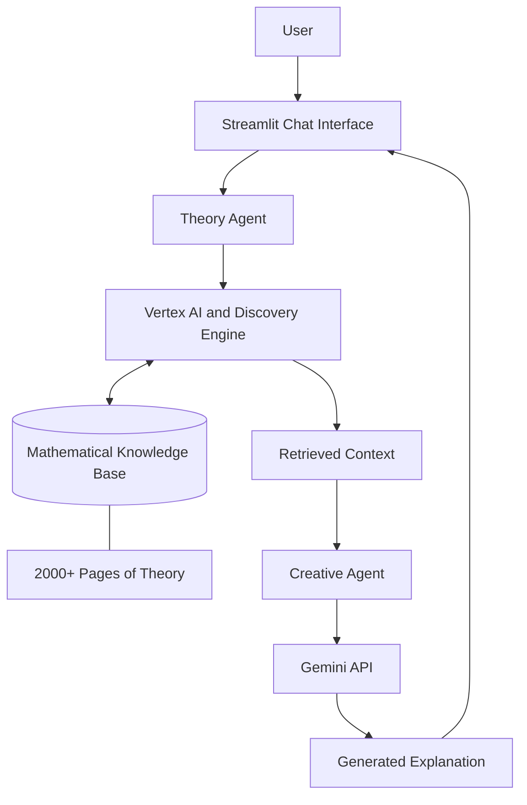

# Study Buddy
### A Multi-Agent AI System for Grounded Mathematical Reasoning

  A mathematics assistant that combines retrieval-augmented generation (RAG) with AI-powered explanations to deliver source-grounded, conversational answers.
    
  
  
  
  

---

## Overview

Study Buddy is a multi-agent AI system designed to make mathematical explanations more reliable, accessible, and grounded in verified reference material.

Developed over four months as an MYP Personal Project, the system combines a knowledge base of over 2,000 pages of mathematical theory with specialized AI agents for information retrieval and natural-language explanation. Its subject coverage focuses on algebra and geometry, spanning high school to university-level material.

By separating retrieval from response generation, Study Buddy aims to reduce unsupported claims and improve the reliability of AI-generated mathematical explanations.

## Key Features

- **Source-grounded retrieval:** Retrieves relevant mathematical material from a dedicated knowledge base.
- **Multi-agent architecture:** Separates theoretical information retrieval from conversational response generation.
- **Step-by-step explanations:** Presents mathematical concepts and solutions in clear, accessible language.
- **Conversational interaction:** Supports follow-up questions and maintains context throughout a conversation.
- **Cloud-based infrastructure:** Integrates Google Cloud services with the Gemini API.
- **Cost-efficient implementation:** Reported total cloud cost of €1.05.

## How It Works

Study Buddy consists of two specialized agents that work together to answer mathematical questions.

### 1. Theory Agent

**Technologies:** Google Cloud Vertex AI and Discovery Engine

The Theory Agent is responsible for retrieving relevant information from a knowledge base containing more than 2,000 pages of mathematical theory.

Its primary responsibilities are:

- Searching for relevant mathematical concepts and reference material.
- Retrieving information to ground the generated response.
- Providing theoretical context for the explanation agent.

### 2. Creative Agent

**Technology:** Gemini API

The Creative Agent processes the information retrieved by the Theory Agent and converts it into a clear, conversational explanation.

Its primary responsibilities are:

- Explaining mathematical concepts in plain language.
- Structuring solutions into understandable steps.
- Responding to follow-up questions while maintaining conversational context.

## System Architecture

The architecture separates knowledge retrieval from natural-language generation, allowing the system to use relevant reference material as the foundation for its answers.

## Technology Stack

| Technology | Purpose |
|---|---|
| Google Cloud Vertex AI | Theory Agent infrastructure |
| Discovery Engine | Knowledge retrieval and search |
| Gemini API | Natural-language explanation and conversation |
| Streamlit | Interactive chat interface |
| Python | Core application logic |

## Project Details

| Attribute | Details |
|---|---|
| Project type | MYP Personal Project |
| Development period | 4 months |
| Knowledge base | 2,000+ pages |
| Main subject areas | Algebra and geometry |
| Reported cloud cost | €1.05 |

## Motivation

Large language models can generate convincing explanations while still making mathematical errors or presenting unsupported claims.

Study Buddy explores an alternative approach: combining information retrieval from a dedicated mathematical knowledge base with the language-generation capabilities of a specialized AI model.

The goal is to make mathematical assistance more transparent and dependable by grounding explanations in relevant source material rather than relying exclusively on the model's internal knowledge.

Retrieval can reduce unsupported answers, although it does not eliminate errors. The accuracy of the final response still depends on the quality of the retrieved material and the reasoning performed by the language model.

## Future Improvements

Potential directions for further development include:

- Adding source citations to individual steps in mathematical explanations.
- Evaluating answer accuracy against a curated set of mathematical problems.
- Expanding the knowledge base to cover additional mathematical topics.
- Improving retrieval relevance for complex, multi-step problems.
- Introducing automated tests to measure reliability and consistency.

---

**Developed as an MYP Personal Project.**
