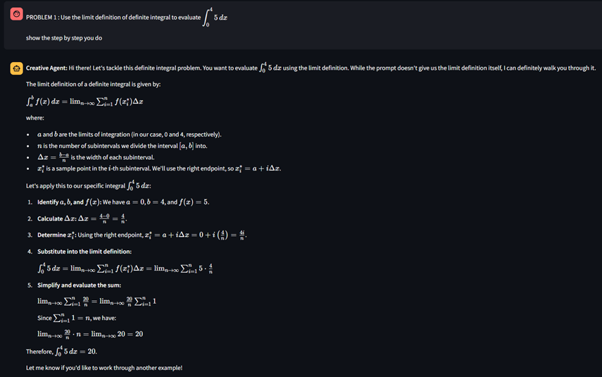
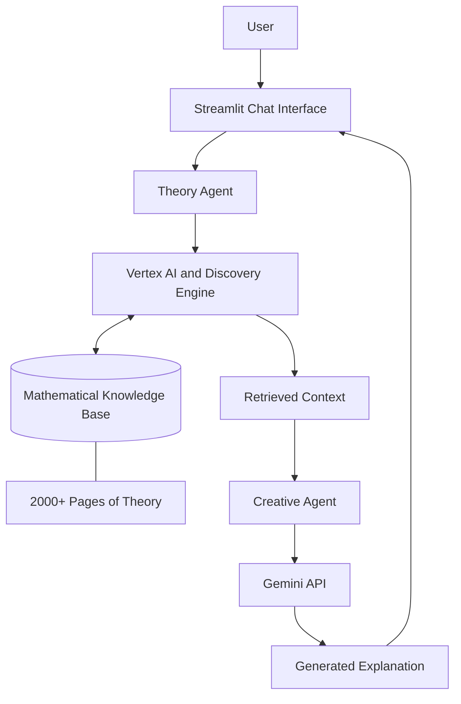

# Study Buddy
### A Multi-Agent AI System for Grounded Mathematical Reasoning

  
  
  
  

  

  <em>Study Buddy in action — demonstrating the application's working interface.</em>

---

## Overview

Study Buddy is a multi-agent AI system designed to make mathematical explanations more reliable, accessible, and grounded in mathematical reference material.

Developed over four months as an MYP Personal Project, the system combines a knowledge base containing more than 2,000 pages of mathematical theory with specialized AI agents for information retrieval and natural-language explanation.

Its subject coverage focuses on algebra and geometry, spanning high school to university-level material.

By separating retrieval from response generation, Study Buddy aims to reduce unsupported claims and improve the reliability of AI-generated mathematical explanations.

## Key Features

- **Source-grounded retrieval:** Retrieves relevant mathematical material from a dedicated knowledge base.
- **Multi-agent architecture:** Separates theoretical information retrieval from conversational response generation.
- **Step-by-step explanations:** Presents mathematical concepts and solutions in accessible language.
- **Conversational interaction:** Supports follow-up questions and contextual explanations.
- **Cloud-based infrastructure:** Integrates Google Cloud services with the Gemini API.
- **Cost-efficient implementation:** Reported total cloud cost of €1.05.

## How It Works

### Theory Agent

**Technologies:** Google Cloud Vertex AI and Discovery Engine

The Theory Agent searches a knowledge base of more than 2,000 pages of mathematical theory to retrieve relevant information and provide supporting context for generated answers.

### Creative Agent

**Technology:** Gemini API

The Creative Agent transforms the retrieved information into clear, conversational explanations. It handles follow-up questions, maintains conversational context, and presents mathematical reasoning step by step.

## System Architecture

## Technology Stack

| Technology | Purpose |
|---|---|
| Python | Core application logic |
| Google Cloud Vertex AI | Theory Agent infrastructure |
| Discovery Engine | Knowledge retrieval |
| Gemini API | Response generation |
| Streamlit | Interactive chat interface |

## Project Details

| Attribute | Details |
|---|---|
| Project type | MYP Personal Project |
| Development period | 4 months |
| Knowledge base | 2,000+ pages |
| Subject areas | Algebra and geometry |
| Reported cloud cost | €1.05 |

## Motivation

Large language models can produce convincing explanations that nevertheless contain mathematical errors or unsupported claims.

Study Buddy explores an alternative approach by combining retrieval from a dedicated mathematical knowledge base with the language-generation capabilities of Gemini.

The objective is to make mathematical assistance more dependable by grounding explanations in relevant source material. Retrieval can reduce unsupported responses, although it cannot guarantee that every answer is correct.

## Future Improvements

- Add source citations to individual mathematical explanations.
- Evaluate answer accuracy against a curated set of problems.
- Expand the knowledge base to additional mathematical topics.
- Improve retrieval for complex, multi-step questions.
- Introduce automated tests for reliability and consistency.

---

**Developed as an MYP Personal Project.**
